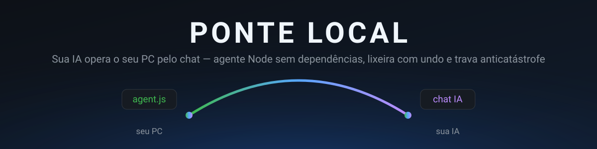

<div align="center">



**Sua IA opera o seu PC pelo chat — com segurança de verdade.**

[](LICENSE)
[](https://nodejs.org)
[](#requisitos)
[](#como-funciona)
[](SKILL.md)
[](#contribuindo)

</div>

---

> 🤖 **Você é uma IA** (Claude, ChatGPT, Gemini, Cursor, agente de código)?
> **Leia [`SKILL.md`](SKILL.md) primeiro.** Ele é uma skill completa: passo a passo
> para você instalar a ponte, o que pedir ao usuário, a tabela das 20 ações e as
> regras de segurança. Comece pela **Regra de Ouro #0: pergunte se o PC é Windows ou Linux.**

## O que é

Um **agente de um arquivo só** (`agent.js`, Node puro, zero dependências) roda no
seu PC e conversa com a sua IA através de um **relay** (API routes Next.js que você
hospeda numa VM). A IA enfileira comandos; o agente busca, executa localmente e
devolve o resultado. Nada de portas abertas nem SSH: o agente só faz **requests de
saída** (poll a cada 1,5 s), então funciona atrás de NAT e firewall domésticos.

```
┌──────────────────┐  poll 1,5 s     ┌──────────────────────┐  admin token  ┌────────────┐
│    SEU PC        │ ──────────────► │  relay Next.js       │ ────────────► │    IA      │
│  Windows/Linux   │ ◄────────────── │  /api/ponte/*        │ ◄──────────── │ (chat ou   │
│    agent.js      │  POST /result   │  URL pública https   │  injeta cmd   │  agente)   │
│   (zero deps)    │                 │  fila + resultados   │  + lê resposta│            │
└──────────────────┘                 └──────────────────────┘               └────────────┘
```

- **Agente** (seu PC) — 20 ações de arquivo e comando, escopo travado na sua home,
  lixeira com desfazer e trava anticatástrofe no próprio processo, antes de executar.
- **Relay** (VM/servidor) — fila com entrega exclusiva (claim/lease), sequência
  persistida em disco e painel web com status em tempo real.
- **Operador** (CLI Python na VM) — `ponte.py`: a IA injeta comandos e lê resultados
  pelo terminal, com binários em base64 (`enviar`/`pegar`).

## Segurança em camadas

| Camada | O que faz |
|--------|-----------|
| 🔒 **Escopo na home** | O agente recusa qualquer caminho fora da home do usuário — `.ssh`, `.gnupg`, `.config`, `.password-store`, `.aws`, `.kube` e a própria pasta `ponte-agent` são inacessíveis |
| 🗑️ **Lixeira + undo** | Nada é apagado de verdade: `delete` e substituições vão para a lixeira do agente, com log JSONL auditável e `undo_last`/`restore` |
| 🧨 **Trava anticatástrofe** | No modo autônomo, comandos de destruição em massa são recusados localmente: fork bomb, `mkfs`, `wipefs`, `dd of=/dev/*`, `shred` em disco, `rm -r` de sistema — e, no Windows, `format`, `diskpart`, `cipher /w`, `vssadmin delete shadows`, `rd /s`/`del /s`/`Remove-Item -Recurse` em raiz de drive, `C:\Windows`, `C:\Program Files` ou `$HOME` |
| 🎛️ **Escalada física** | `run_command` só funciona nos modos que **você** religa no seu terminal — a IA não consegue ligá-la sozinha, nunca |
| 🔑 **Tokens separados** | Agente e operador usam tokens distintos; comandos de teste ficam num canal isolado |
| 🧾 **Log JSONL** | Toda ação fica registrada em `ponte-log.jsonl`, com resumo e dados de undo |

## Os 3 modos do `run_command`

| Modo | Você religa com | Comportamento |
|------|-----------------|---------------|
| **Desligado** (padrão) | `node agent.js` | Só operações de arquivo — IA não executa comandos |
| **Supervisionado** | `node agent.js --allow-run --save` | Cada comando aparece no **seu** terminal; `s`/`N` em 60 s, sem resposta = rejeita |
| **Autônomo** | `node agent.js --auto --save` | Executa direto (loga `[AUTO] $ cmd`), **com a trava anticatástrofe sempre ativa** |

A troca de modo é sempre **física**: só você, digitando o flag no terminal do seu PC.

## Requisitos

| Onde | O quê |
|------|-------|
| **Seu PC** (Windows ou Linux) | Node.js 18+, `curl` (no Windows, o `curl.exe` nativo do PowerShell) |
| **VM/servidor da IA** | Node.js 18+ para o relay (Next.js), Python 3 opcional para a CLI |

## Comece por aqui

### 🤖 Caminho 1 — deixe a IA instalar (recomendado)

Abra um chat com sua IA e diga: *"leia https://github.com/MicaelSanPedro/ponte-local/blob/main/SKILL.md e instale a ponte pra mim"*. A skill guia tudo: relay, tokens, download do agente, validação e o primeiro comando.

### 🖥️ Caminho 2 — manual

**No servidor** (detalhes completos em [`SKILL.md`](SKILL.md) e [`relay/RESTAURAR.md`](relay/RESTAURAR.md)):

```bash
CI=1 npx create-next-app@latest ponte-relay --typescript --app --no-eslint --src-dir --import-alias "@/*"
cd ponte-relay
# copie os arquivos do repo conforme a tabela da SKILL.md:
#   relay/ponte-store.ts  → src/lib/ponte-store.ts
#   relay/api/*/route.ts  → src/app/api/ponte/*/route.ts
#   relay/painel/page.tsx → src/app/page.tsx
#   agente/agent.js       → download/ponte-agent/agent.js
export PONTE_AGENT_TOKEN=$(openssl rand -hex 12)   # vai para o seu PC
export PONTE_ADMIN_TOKEN=$(openssl rand -hex 16)   # só para quem injeta comandos
npm install lucide-react
npm run dev    # Next.js 16+? deixe cacheComponents: false no next.config.ts (ver SKILL.md)
```

**No seu PC — Linux:**

```bash
mkdir -p ~/ponte-agent && cd ~/ponte-agent
curl -fso agent.js https://raw.githubusercontent.com/MicaelSanPedro/ponte-local/main/agente/agent.js
node agent.js --server https://SEU-RELAY --token SEU_TOKEN --save
```

**No seu PC — Windows (PowerShell):**

```powershell
mkdir "$HOME\ponte-agent" -Force; cd "$HOME\ponte-agent"
curl.exe -fso agent.js https://raw.githubusercontent.com/MicaelSanPedro/ponte-local/main/agente/agent.js
node agent.js --server https://SEU-RELAY --token SEU_TOKEN --save
```

> ⚠️ No PowerShell, use **sempre** `curl.exe` — `curl` sem `.exe` é um alias do
> `Invoke-WebRequest` e quebra o download. Próximas execuções: `~/ponte-agent/rodar.sh`
> (Linux) ou `cd $HOME\ponte-agent; node agent.js` (Windows).

## As 20 ações do agente

| Grupo | Ações |
|-------|-------|
| **Explorar** | `ping` · `list` · `tree` · `search` (nome ou conteúdo) · `free_space` · `disk_usage` |
| **Arquivos** | `read_text` · `write_text` · `mkdir` · `move` · `rename` · `delete` → lixeira · `restore` · `undo_last` |
| **Organizar** | `organize_plan` (propõe, não executa) · `apply_plan` (lote aprovado) · `duplicates` (md5 + espaço recuperável) |
| **Binários** | `read_binary` · `write_binary` (base64, até 8 MB — via `ponte.py pegar`/`enviar`) |
| **Comando** | `run_command` (com os 3 modos acima) |

A referência completa com argumentos exatos está na [tabela da SKILL.md](SKILL.md#fase-4--operar-referência-das-ações).

## Estrutura do repo

```
ponte-local/
├── SKILL.md               ← entrada para IAs: instale e opere (comece aqui)
├── agente/
│   ├── agent.js           ← o agente inteiro: 1 arquivo, 0 dependências (v1.3.0)
│   ├── LEIA-ME.md         ← manual do agente no PC do usuário
│   ├── rodar.sh           ← religa lendo ponte.config.json (Linux)
│   └── atualizar.sh       ← baixa a versão nova do agente (Linux)
├── relay/
│   ├── ponte-store.ts     ← estado do relay: fila, claim/lease, seq em disco
│   ├── api/…/route.ts     ← poll · result · cmd · results · status · download
│   ├── painel/page.tsx    ← painel web (status + bloco de instalação pronto)
│   └── RESTAURAR.md       ← recriar o relay do zero numa VM nova
├── operador/
│   ├── ponte.py           ← CLI do operador (injeta comandos, lê resultados)
│   └── teste-ponte*.sh    ← testes E2E de referência
└── docs/banner.svg        ← banner do repo
```

## Perguntas frequentes

**A IA pode formatar meu PC?** Não. Comandos de destruição em massa são recusados
no próprio agente, antes de executar; arquivos só são apagados para a lixeira, com
undo; e fora da sua home o agente nem enxerga.

**A IA pode ligar o `run_command` sozinha?** Não. O modo só muda com um flag digitado
por você no terminal do seu PC — a escalada é física.

**Preciso abrir portas no meu roteador?** Não. O agente só faz requests de saída
para o relay; o que atravessa a internet é JSON de metadados (nada de conteúdo de
arquivo no ar — binários vão em base64 sob demanda, por comando seu).

**Funciona no Windows?** Sim, desde o agente v1.3.0: `run_command` via `cmd.exe`,
trava anticatástrofe com padrões Windows e lixeira interna do agente (não é a
Lixeira do Windows — restaure com `restore`/`undo_last`).

## Contribuindo

Issues e PRs são bem-vindos — especialmente relatos do agente em outras distros
e no Windows. Para mudanças maiores, abra uma issue antes descrevendo o caso de uso.

## Licença

[MIT](LICENSE) © MicaelSanPedro
